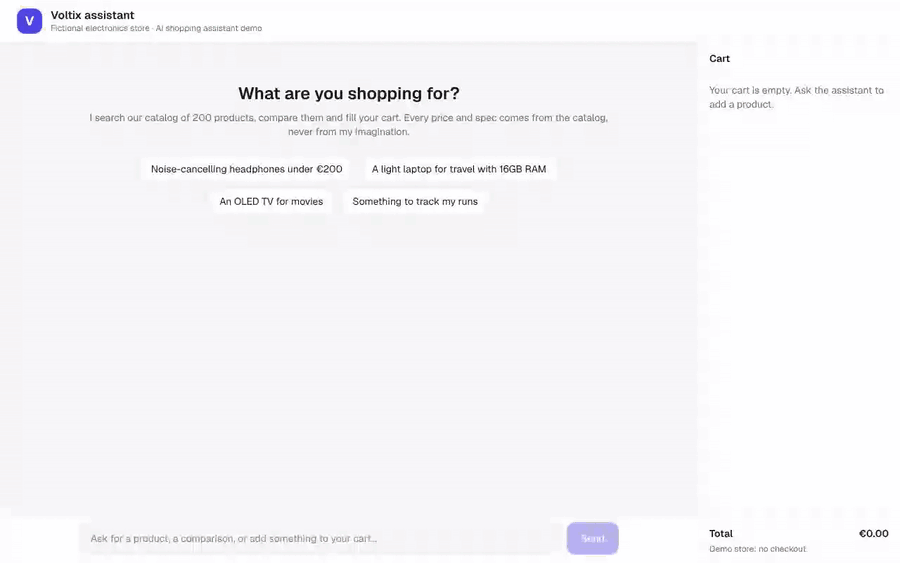
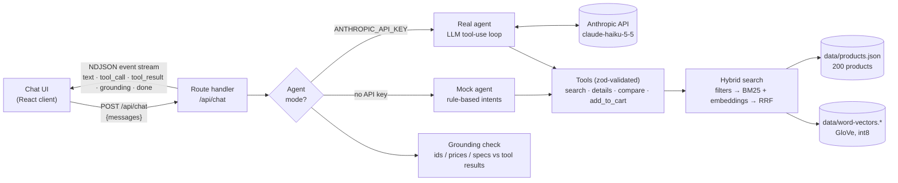

# shop-assistant

**A conversational shopping assistant for a fictional electronics store, built from scratch with LLM tool calling.**
It searches a 200-product catalog (hybrid keyword + semantic search), compares products, adds them to the cart and cites every product it mentions.
It never invents a price or a spec: facts come only from tools, and a deterministic grounding check verifies every answer. It also runs **without an API key** in mock mode.



> Everything here is fictional: the store ("Voltix"), the brands, the products, the prices and the reviews are generated by a seeded script.

## Features

- **Streaming chat** (Next.js App Router, TypeScript) with markdown answers, product cards and a cart.
- **Tool calling** with 4 tools: `search_products` (query + filters), `get_product_details`, `compare_products` (2 to 3 products), `add_to_cart`.
- **Hybrid search**: BM25 keyword ranking + word-vector semantic ranking, fused with Reciprocal Rank Fusion, after hard filters (category, price, rating, stock, specs).
- **Citations**: every product is cited as `[P0042]`, rendered as a chip and a product card.
- **Guardrails**: tool-only facts, validated tool arguments, polite off-topic refusal, and a **grounding check** that flags any id, price or spec figure not returned by a tool.
- **Two modes, same pipeline**:
  - _Mock_ (default, no key): a scripted agent that calls the real tools.
  - _Real_: a hand-written tool-use loop with a cheap model (Claude Haiku 5.5).
- **Evaluation**: 30 test questions, accuracy and hallucination rate, plus a retrieval benchmark.
- **Quality**: 65 Vitest tests, ESLint, strict TypeScript, and a GitHub Actions CI that runs the full mock eval on every push.

## Architecture



What happens in one turn (real mode):

1. The browser sends the conversation as plain text to `POST /api/chat`.
2. The agent calls the model with the system prompt and the 4 tool definitions, and streams the text back.
3. When the model requests tools, the server validates the arguments with zod, runs the tools locally and sends the results back. This repeats until the model answers without calling a tool (max 6 rounds).
4. The final text goes through the grounding check, and the report is streamed to the UI as a ✓ or ⚠ badge.
5. Each step is streamed as one JSON line (NDJSON). Mock and real agents emit exactly the same events, so the UI, tests and eval don't care which one runs.

## Run it locally

Requirements: Node.js 20+.

```bash
git clone https://github.com/Melvin2209/shop-assistant.git
cd shop-assistant
npm install
npm run dev          # http://localhost:3000, mock mode, no key needed
```

To use a real LLM, create `.env.local` from [`.env.example`](.env.example):

```bash
cp .env.example .env.local
# then set ANTHROPIC_API_KEY=sk-ant-...  (optional: ANTHROPIC_MODEL, ASSISTANT_MODE=mock|real)
npm run dev
```

The badge in the header shows which mode is live.

| Command                    | What it does                                                     |
| -------------------------- | ---------------------------------------------------------------- |
| `npm run dev`              | Start the app                                                    |
| `npm test`                 | Run the 65 unit and integration tests (mock mode, free, offline) |
| `npm run lint`             | ESLint                                                           |
| `npm run typecheck`        | TypeScript, strict mode                                          |
| `npm run eval`             | Run the 30-question eval on the mock agent                       |
| `npm run eval -- --real`   | Run the eval on the real LLM (needs a key, costs a few cents)    |
| `npm run catalog:generate` | Regenerate `data/products.json` (deterministic, seed 42)         |

## How it works

### Tool calling (`src/lib/agent/real.ts`)

The real agent is a plain loop over the Anthropic Messages API using the official TypeScript SDK. No agent framework is involved, so each step is visible:

- **Model:** `claude-haiku-5-5` at `effort: "low"`. A shopping answer needs speed more than deep reasoning.
- **Within a turn:** the history is append-only, and the assistant content is sent back untouched next to the `tool_result` blocks.
- **Across turns:** only the text is replayed. Because answers cite `[P0042]`, the model can still resolve follow-ups like _"add the second one to my cart"_.
- **Errors:**
  - Tool errors are returned to the model with `is_error: true` (e.g. "out of stock", "unknown id") so it can recover.
  - API errors are mapped to short, user-safe messages.
  - `max_tokens` and `refusal` stop reasons are handled explicitly.
- **Tests:** a fake Anthropic client in `agent.test.ts` drives the loop without network access.

### Hybrid search (`src/lib/search/`)

1. **Hard filters first** (category, brand, price, rating, stock, tags, spec ranges). A product over budget must never appear, however relevant it is.
2. **BM25** keyword ranking, implemented in about 50 lines (`bm25.ts`).
3. **Semantic ranking** with static word embeddings:
   - Each text is an IDF-weighted average of 100-d GloVe vectors.
   - The mean vector is subtracted ("common component removal", from the SIF paper) to spread the similarities apart.
   - This lets `"jogging"` find running watches and `"binge-watching series"` find TVs, words that appear in no product text.
4. **Reciprocal Rank Fusion** merges the two rankings using ranks only, so BM25 scores never have to be calibrated against cosine similarities.

Why static word vectors and not a transformer model? The usual local option (`transformers.js`) pulls in a 288 MB native ONNX runtime, which goes against "anyone can `npm install` and try it". Instead, `scripts/build-word-vectors.ts` extracts 50k words from the MIT-licensed `wink-embeddings-sg-100d` GloVe vectors and quantizes them to int8 (~5 MB, committed). It's pure TypeScript and computes the whole catalog in milliseconds. The `Embedder` interface makes it easy to swap in an embeddings API.

### Guardrails

| Risk                   | Mitigation                                                                                                                                                                                                      |
| ---------------------- | --------------------------------------------------------------------------------------------------------------------------------------------------------------------------------------------------------------- |
| Invented price or spec | System prompt rule "facts only from tools" **and** the grounding check (`grounding.ts`): every `[Pxxxx]`, `€` amount and number + unit ("16 GB", "65-inch") must match a tool result or the user's own message. |
| Invented product       | Citations must be ids returned by a tool in the same turn; unknown ids are flagged.                                                                                                                             |
| Malformed tool call    | Zod validation of every argument; tools never throw and return actionable errors.                                                                                                                               |
| Off-topic or injection | Prompt rule to decline politely and steer back to shopping (tested in the eval, including "ignore previous instructions").                                                                                      |
| Runaway loop / cost    | Max 6 tool rounds per turn, request size limits on `/api/chat`, cheap model, low effort.                                                                                                                        |
| Unwanted purchase      | `add_to_cart` only on explicit request; it checks stock; the cart lives client-side (no checkout).                                                                                                              |

The grounding check is a heuristic (regexes), not a proof. It allows simple derived amounts (2 × price, the difference between two prices, rounding) and can miss facts written in words ("sixteen gigabytes"). It is cheap, deterministic, runs on every answer, and doubles as the eval's hallucination metric.

### Mock mode (`src/lib/agent/mock/`)

Without a key, a rule-based agent takes the LLM's place:

- It detects the intent with regexes (search, details, compare, cart, greeting, off-topic, unsupported product) and extracts filters ("under €800", "16GB RAM", "OLED", "gaming").
- It resolves references ("the first two", "it") from the previous answer.
- It calls **the same tools** and writes answers from templates filled with tool data.

The demo is therefore fully functional, the tests cost nothing, and the UI is identical in both modes.

## Evaluation

`eval/dataset.json` holds 30 questions across 9 types:

- search with filters (10)
- vague or semantic requests (3)
- product details (3)
- comparisons (2)
- cart, including an out-of-stock product (3)
- no result (2)
- products we don't sell (2)
- off-topic and prompt injection (4)
- a hallucination trap: asking for the warranty, which is not in the catalog (1)

Each case has machine-checkable expectations, so there is no LLM-as-judge:

- **Product constraints:** every cited product must satisfy constraints such as _laptop, ≤ €800, RAM ≥ 16 GB_. This makes the check robust to ranking differences between models.
- **Expected tool calls** and **expected cart additions**.
- **Regexes** on the answer, e.g. a refusal must mention shopping and must not say "Paris".

Metrics:

- **Correct**: every expectation of the case holds.
- **Hallucination**: the grounding check finds at least one cited id, price or spec figure that no tool returned during the turn.

### Results

#### Mock agent (`npm run eval`, deterministic, also enforced in CI)

| Metric                       | Value           |
| ---------------------------- | --------------- |
| Correct answers              | **29/30 (97%)** |
| Answers with a hallucination | **0/30 (0%)**   |

| Question type | search | semantic | details | compare | cart | no result | unsupported | off-topic | trap |
| ------------- | ------ | -------- | ------- | ------- | ---- | --------- | ----------- | --------- | ---- |
| Correct       | 10/10  | 3/3      | 3/3     | 2/2     | 3/3  | 2/2       | 2/2         | 4/4       | 0/1  |

How to read these numbers:

- The mock's 0% hallucination rate holds **by construction**: its answers are templates filled with tool data.
- Its rules were written by the same person as the test set, and refined after a first run (23/30) by adding generic attribute extraction (type, sensor, MP, ATM, use-case tags, product names). This score is therefore a **pipeline regression test**, not a measure of intelligence.
- The one failure is honest: a rule-based agent can't realize that "warranty" is information it doesn't have. That is exactly what the LLM is for.

#### Real LLM (`npm run eval -- --real`)

Run it with your own key: `npm run eval -- --real`. It writes `eval/results/real.md`, ready to paste here. With Claude Haiku 5.5, the 30 questions cost a few cents.

> The numbers above were produced in an environment without an API key, so no real-mode results are published yet. I prefer an empty cell to an invented one: same rule as the assistant.

#### Retrieval benchmark (search engine only)

Each of the 11 search questions is sent as raw text to the search engine, with no filters extracted. We measure how many of the top 5 results satisfy the case's constraints:

| Search mode | Precision@5 | Hit@5 |
| ----------- | ----------- | ----- |
| Keyword     | 69%         | 91%   |
| Semantic    | 42%         | 82%   |
| Hybrid      | 56%         | 82%   |

An honest finding: on these constraint-heavy questions ("OLED", "full-frame", "GPS", "stylus"), **plain BM25 wins**, because the constraint words appear literally in the product data. Semantic search helps when the vocabulary doesn't match ("jogging", "binge-watching", covered by unit tests), but static word vectors are a weak semantic model. In the product, hard constraints are handled by **structured filters** (the LLM or mock fills `max_price`, `specs`...), not by text relevance. I did not tune the fusion weights on these 11 questions, to avoid overfitting the eval. The next steps would be a larger labelled query set, then a sentence-embedding model and a weighted RRF.

## Technical choices

- **Official Anthropic SDK + a hand-written loop**, rather than an agent framework. The loop is about 60 lines, and every step (streaming, tool execution, error handling) can be explained and tested.
- **Zod schemas as the single source of truth** for tools: they validate model output and are converted to JSON Schema for the API (`z.toJSONSchema`).
- **NDJSON over a plain `ReadableStream`**: one JSON event per line. It is simpler than SSE for a POST request and trivial to parse and test (`splitNdjson`).
- **Stateless server, client-side cart**: no database, nothing to deploy beyond Next.js. The server only receives the text history.
- **Seeded, generated catalog**: reproducible data, so tests and eval expectations are stable, with no real brand or retailer data.
- **The eval as a CI test**: the mock run is deterministic, so a regression in search, tools, intents or grounding fails the build.

## Limitations and next steps

- **The mock agent is English-only** and rule-based. Use real mode for open conversation and other languages.
- **Grounding is regex-based.** It catches figures and ids, not wrong qualitative claims ("this is the lightest"). Next: check comparative claims against the tool data, or add an LLM judge for the eval only.
- **Static word vectors are a weak semantic model** (see the benchmark). Next: sentence embeddings (local model or API), precomputed for the catalog.
- **The cart lives in the browser** and is not persisted. A real store would sync it server-side and re-check stock and prices at checkout.
- **No auth or rate limiting** beyond request size limits. Add both before exposing real mode publicly.
- **Small eval set** (30 questions, written by the author). Next: real anonymized queries, a train/test split for tuning, multi-turn scenarios.

## Project structure

```
src/
  app/                 Next.js pages and API routes (/api/chat, /api/mode)
  components/          Chat, Message, ProductCard, CartPanel
  lib/
    catalog/           Product types, seeded generator, catalog loader
    search/            Tokenizer, BM25, word-vector embeddings, hybrid search
    tools/             Zod schemas, tool implementations, API tool definitions
    agent/             System prompt, real agent, mock agent, grounding check
    client/            Pure UI state helpers (event reducer, NDJSON, cart)
data/                  products.json + word vectors (committed)
eval/                  dataset, scoring, runner, results
scripts/               catalog and word-vector generation
```

## Credits

- Word vectors: [`wink-embeddings-sg-100d`](https://github.com/winkjs/wink-embeddings-sg-100d) (MIT), derived from [Stanford GloVe](https://nlp.stanford.edu/projects/glove/) (PDDL).
- All store, brand and product data is fictional and generated by `scripts/generate-catalog.ts`.

MIT License.
